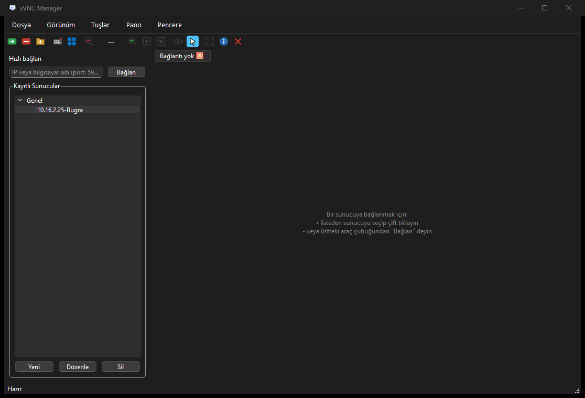

# xVNC Manager

**Sürüm 0.99** · Geliştiren: **MiMo with Şahin AKIN**

Bağlantı yöneticili, Qt 6 ile yazılmış Windows masaüstü VNC viewer'ı. TightVNC 2
sunucularına tam destek verir: ekran görüntüleme, izleme/kontrol modu ve **çift
panelli dosya transferi** (TightVNC 2'nin 0xFC alt protokolü). Arayüz Türkçedir.



---

## Özellikler

### Bağlantı yönetimi
- Kayıtlı sunucu listesi (`%APPDATA%\xVNC\xVNCManager\connections.json`)
- **Gruplar:** yan liste ağaç görünümünde gruplanır (ör. *Saha*, *Ofis*);
  gruplar alfabetik, kayıtsız kayıtlar varsayılan **Genel** grubunda
- Grup menüsü: *Yeni bağlantı…*, *Tümünü aç/kapat*; gruplar açılır/kapanır,
  seçim ve açık/kapalı durum yenilemede korunur
- Şifreler Windows **DPAPI** ile kullanıcıya özel şifrelenerek saklanır
- Hızlı bağlan çubuğu (`sunucu:5900` veya `vnc://sunucu:5900`)
- Bağlantı bilgi penceresi (grup, sunucu, port, kimlik doğrulama bilgileri)

### Görüntüleme ve kontrol
- Çoklu sekme; her sekme bağımsız bir oturum
- **İzleme / kontrol modu** (yalnızca görüntüleme ↔ tam kontrol)
- Ekran kodlamaları: **Tight** (sıkıştırma + JPEG), ZRLE, Hextile, CoRRE, RRE,
  CopyRect, Raw — JPEG tarafı libjpeg-turbo ile hızlı çözülür
- Ölçeklendirme: pencereye sığdır (`Ctrl+0`), 1:1 (`Ctrl+1`), yakınlaştırma
  (`Ctrl+tekerlek` ve menü) — çift tık uzak ekrana gider, zoom'u çalmaz
- Tam ekran (`F11`, çıkış için `Esc`)
- Fare (tekerlek dâhil) ve klavye gönderimi (X11 keysym eşleme)
- Pano eşitleme (sunucu ↔ istemci, *Pano* menüsü)
- Özel tuşlar (*Tuşlar* menüsü: Ctrl+Alt+Del vb.)

### Dosya transferi (TightVNC 2.x)
- Çift panel: **yerel ↔ uzak**, sürücü listesi (`C:`, `D:` …) ve klasör gezinme
- İndirme, yükleme (64 KiB'lık parçalar, akış kontrolülü ping-pong)
- Klasör oluşturma, silme, yeniden adlandırma, klasör boyutu sorma
- Silme işlemleri için onay diyalogları; dolu klasör silmede önceden uyarı
- Sunucu hataları **Türkçeye çevrilir** (ör. *hata 145 → "Klasör boş değil;
  önce içeriğini silin."*), tanınmayan kodlar olduğu gibi gösterilir
- Dosya transferi yalnız sunucuda etkinse görünür (etkileşim yetenekleri
  `ft=var` olarak tespit edilir)

### Uygulama
- **Tek exe statik dağıtım: 17,5 MB** (DLL gerekmez) veya DLL'li dinamik sürüm
- SVG araç çubuğu ikonları, uygulama ikonu, koyu modern görünüm
- EXE özelliklerinde sürüm bilgisi: *xVNC Manager · 0.99 ·
  Geliştiren MiMo with Şahin AKIN*
- Türkçe arayüz; hata ayıklama günlüğü `build\xvncmanager.log`

---

## Hangi VNC sunucularıyla çalışır?

| Sunucu | Görüntüleme | Dosya transferi | Not |
|---|:---:|:---:|---|
| **TightVNC 2.x** (2.8.x test edildi) | ✅ | ✅ | Tam destek: Tight güvenlik tipi 16 + 0xFC dosya transferi |
| TigerVNC, TurboVNC, RealVNC (standart) | ✅ | — | RFB 3.3/3.8, *None* / *VNC Auth* |
| UltraVNC (görüntüleme) | ✅ | — | Kendi dosya transferi (tip 7) **desteklenmiyor** |
| x11vnc, LibVNCServer tabanlı, tightvnc 1.x | ✅ | — | Standart RFB |
| RealVNC kurumsal (RA2/RA2ne, sertifika) | ❌ | ❌ | Sunucuda **VNC Password** kimlik doğrulamasını açın |
| VeNCrypt / TLS güvenlik tipleri | ❌ | ❌ | TLS desteği bu derlemede kapalı |

- **Güvenlik tipleri:** *None* (1), *VNC Auth* (2), *Tight* (16, uzantı üzerinden
  tercih edilir — libvncclient'a özel yama ile).
- **Dosya transferi yalnızca TightVNC 2'ye özgüdür**; UltraVNC/LibVNCServer'ın
  tip-7 protokolü farklı ve uyumsuzdur (araştırma: `docs/filetransfer-protocol-type7-legacy.md`).
- TightVNC 2'de RA2 (*RSA-AES*) etkinse libvncclient bu tipleri çözemez;
  sunucuda klasik *VNC Password* seçin.

---

## Kullanılan teknolojiler

| Bileşen | Seçim |
|---|---|
| Programlama dili | **C++17** (MSVC `/W4 /utf-8 /permissive-` temiz) |
| Arayüz | **Qt 6.8.3** Widgets (SVG ikonlar için QtSvg), statik veya dinamik |
| RFB istemcisi | **libvncclient** (LibVNCServer projesi, GPL-2.0-or-later) — vcpkg *overlay port* ile **statik**, 1 özel yama: uzantı güvenlik tipleri tercihi |
| Sıkıştırma | **zlib** + **libjpeg-turbo** (vcpkg) |
| Depolama | JSON (bağlantı listesi) + **Windows DPAPI** (şifreler, `crypt32`) |
| Derleme | **CMake ≥ 3.21 + Ninja** + MSVC (VS2019 BuildTools, toolset **14.29** — Qt 6.8 LTS ile doğrulandı) |
| Paket yönetimi | **vcpkg** (`x64-windows` / `x64-windows-static`) + `overlay-ports/` |

---

## Derleme

Gereksinimler:

- Visual Studio 2019 BuildTools (C++ bileşeni, `vcvars64.bat`)
- CMake ≥ 3.21 ve Ninja
- Qt 6.8.3 (`msvc2022_64`); **statik sürüm için** yerelde statik qtbase + qtsvg
  derlemesi gerekir (`/MT`; Qt'nin MSVC sürüm denetimi VS2019 toolseti için
  1930 → 1929 yamalanır)
- vcpkg
- Windows 10 SDK (`rc.exe`, exe ikonu/sürüm kaynağı için)

**Makineye özel yollar git'e girmez.** Depo kökünde (`.gitignore`'da)
`local.env.cmd` oluşturup Qt ve vcpkg konumlarınızı tanımlayın — preset'ler
`$env{QTDIR}`, `$env{QTDIR_STATIC}` ve `$env{VCPKG_ROOT}` makrolarını okur:

```bat
@echo off
set "QTDIR=C:\Qt\6.8.3\msvc2022_64"
set "QTDIR_STATIC=C:\Qt\6.8.3-static"
set "VCPKG_ROOT=C:\src\vcpkg"
```

Ardından betikleri çalıştırın (betikler `vcvars64.bat`'ı kendisi çağırır):

```powershell
.\build.cmd          # dinamik sürüm (~25 MB klasör: exe + gerekli DLL'ler)
.\build-static.cmd   # statik sürüm (tek exe, 17,5 MB — dağıtımı bunu kullanın)
.\build-debug.cmd    # hata ayıklama derlemesi
```

vcpkg bağımlılıkları (zlib, libjpeg-turbo, libvncserver) yapılandırma sırasında
otomatik kurulur; elle kurmak isterseniz:

```powershell
& "$env:VCPKG_ROOT\vcpkg.exe" install `
    --triplet x64-windows `
    --overlay-ports=.\overlay-ports `
    --x-manifest-root=.
```

Preset'ler: `default` (release), `debug`, `release-static` — hepsi Ninja +
`vcvars64.bat` ortamı ister.

---

## Kullanım

1. **Yeni** ile sunucu kaydı oluşturun (ad, IP, port, VNC şifresi, **grup**).
2. Listede çift tıklayın ya da **F5** ile bağlanın.
3. *Dosya Transferi* menüsü ile çift paneli açın; klasörler arası geçiş çift
   tıklama ile olur (dosyada indirme başlar).
4. *Görünüm/Tuşlar/Pano* menülerinden izleme-kontrol, özel tuş ve pano
   işlemlerine erişin.
5. Sekme başlığındaki `[kopuk]` ifadesi oturumun koptuğunu gösterir; yeni
   bağlantı açarak tekrar deneyin.

### Kısayollar

| Kısayol | İşlev |
|---|---|
| `F5` | Seçili sunucuya bağlan |
| `F11` | Tam ekran (çıkış için `Esc`) |
| `Ctrl+0` / `Ctrl+1` | Pencereye sığdır / 1:1 |
| `Ctrl+tekerlek` | Yakınlaştırma |
| `Ctrl+W` | Aktif sekmeyi kapat |
| `Ctrl+Tab` | Sonraki sekme |
| `Ctrl+N` | Yeni bağlantı |
| `Ctrl+E` | Seçili bağlantıyı düzenle |
| `Del` | Seçili bağlantıyı sil |

---

## Mimari

| Katman | Uygulama |
|---|---|
| UI | Qt Widgets: `MainWindow`, `VncView`, `ConnectionDialog`, `FileTransferDialog` |
| RFB istemcisi | **libvncclient**, arka plan `std::thread` içinde (`VncSession`) |
| FT protokolü | `FtProtocol.h` (0xFC mesaj yapıcı/ayrıştırıcı), durum makinesi `VncSession::FtState` |
| Depolama | `ConnectionStore` (JSON) + `SecretStore` (DPAPI) |

`VncSession` libvncclient'in `rfbClient` yapısını sarmalayarak:

1. `rfbInitClient()` ile el sıkışma ve kimlik doğrulamayı yapar (Tight tip 16
   uzantı kaydı `rfbInitClient`'dan önce yapılır),
2. `WaitForMessage()` / `HandleRFBServerMessage()` döngüsünü ayrı bir iş
   parçacığında çalıştırır; bilinmeyen `0xFC` mesajları uzantı kancası tarafından
   devralınır (FT akışı),
3. Framebuffer güncellemelerini `QImage`'e kopyalayıp Qt olay döngüsüne
   kuyruklu sinyallerle taşır,
4. Fare/klavye/pano olaylarını mutex korumalı kuyrukle istemci parçacığına iletir.

### Protokol belgeleri

- [`docs/filetransfer-protocol.md`](docs/filetransfer-protocol.md) — TightVNC 2.x
  0xFC dosya transferi protokolünün tam kataloğu (mesaj dizileri, sıkıştırma
  bloğu, NUL/u16 tuzakları, kaynak satır alıntılarıyla)
- [`docs/filetransfer-protocol-type7-legacy.md`](docs/filetransfer-protocol-type7-legacy.md) —
  UltraVNC/LibVNCServer tip-7 protokolü araştırması (kullanılmıyor, referans)

---

## Sınırlamalar

- Dosya transferi **yalnızca TightVNC 2.x** ile çalışır; tek oturumda tek
  transfer (sunucu tarafı tek yükleme/indirme slotu kullanır).
- Özyinelemeli klasör silme protokolde yoktur; dolu klasör *hata 145* ile
  reddedilir (arayüzde Türkçe açıklamasıyla gösterilir).
- RA2/RA2ne (RSA-AES) ve VeNCrypt/TLS kimlik doğrulamaları desteklenmez.

---

## Lisans

**GPL-2.0-or-later.** `libvncclient` GPL-2.0-or-later lisanslıdır ve bu proje
onu **statik** bağlar; kaynak koduyla birlikte dağıtılan uygulama da GPL altında
olmalıdır. Ayrıntılar için [LICENSE](LICENSE) dosyasına bakın.

> © 2026 — Geliştiren: MiMo with Şahin AKIN
